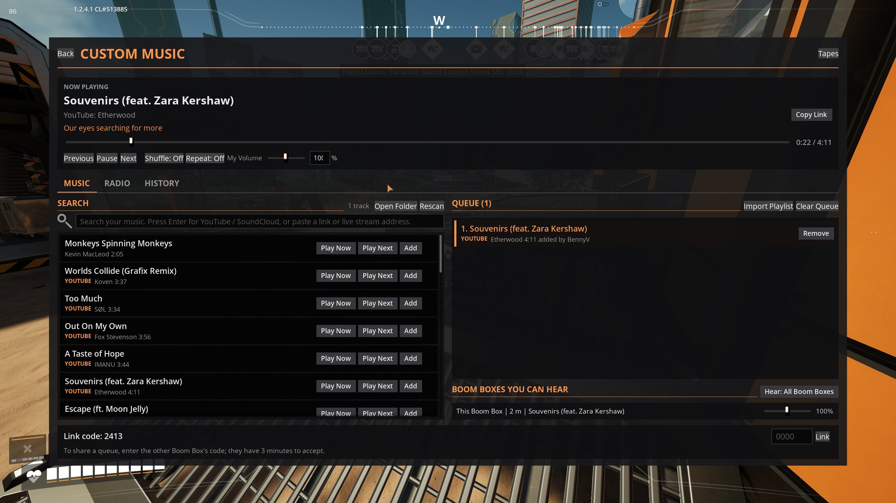
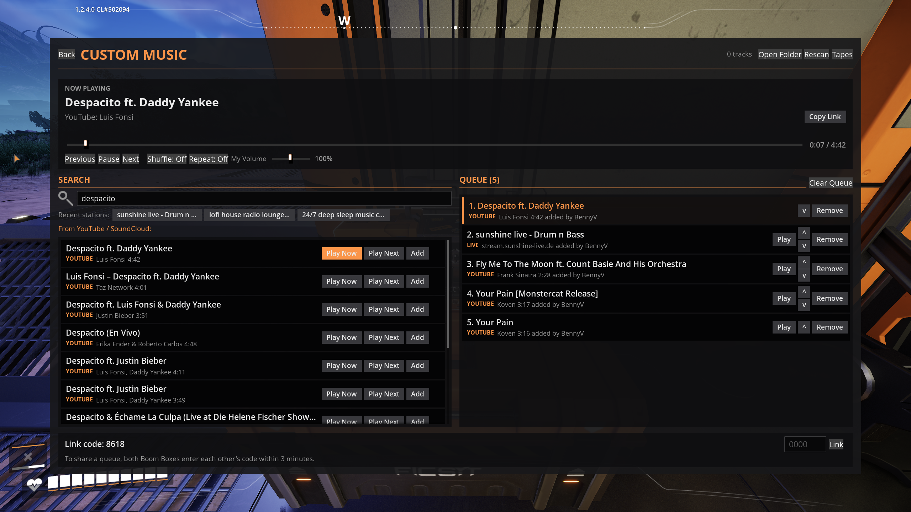
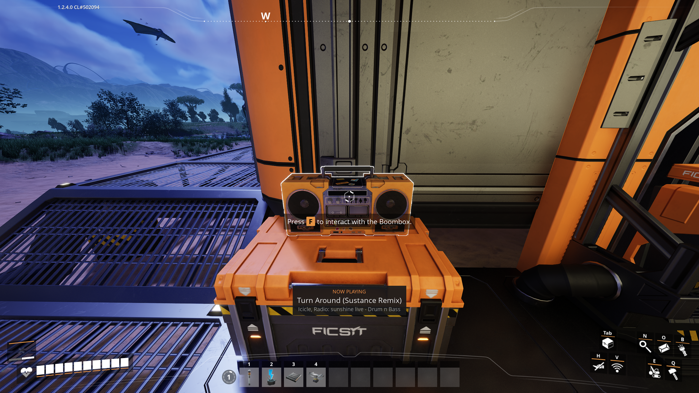
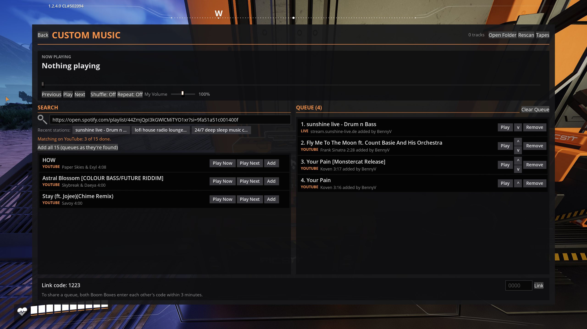
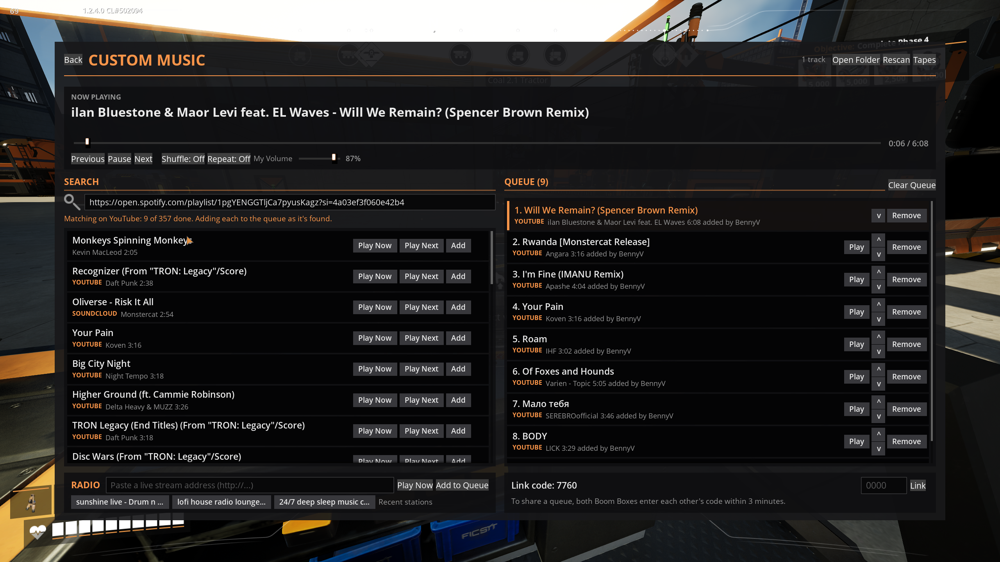
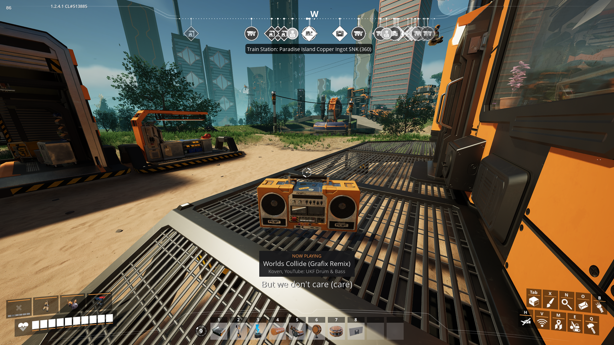
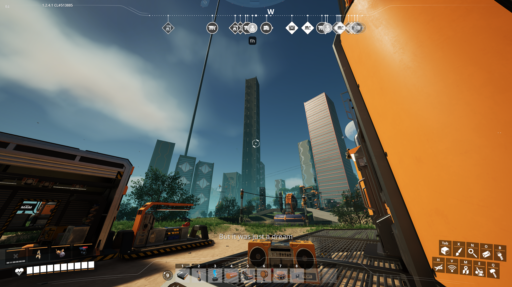
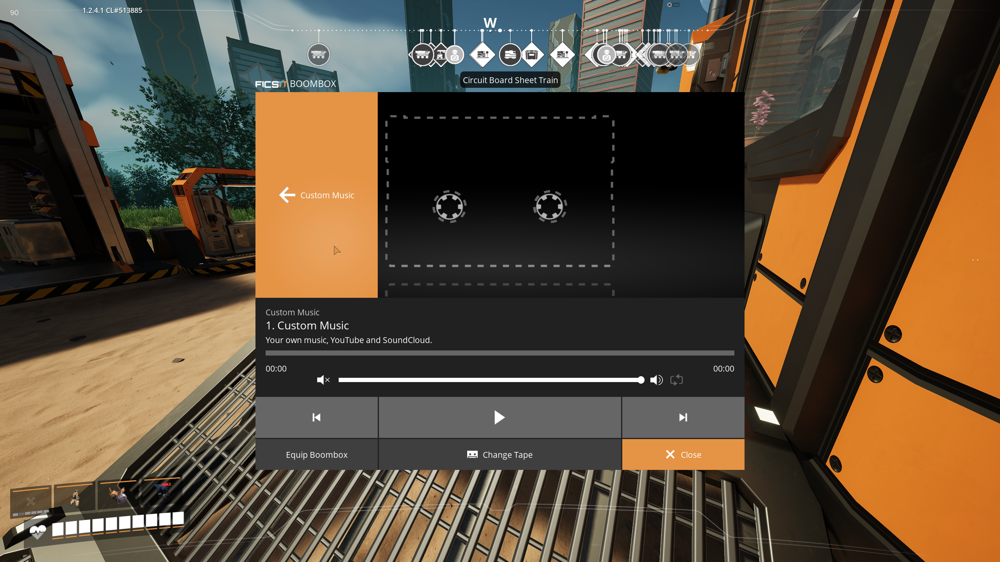
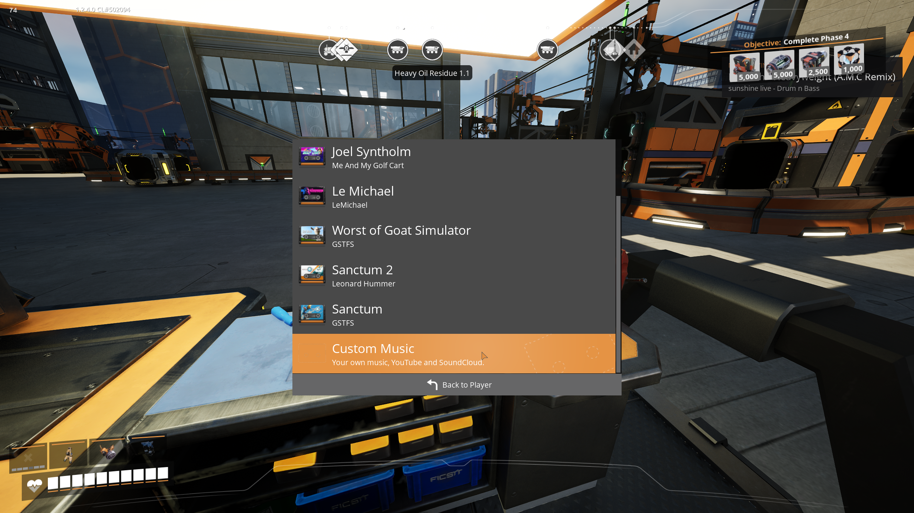
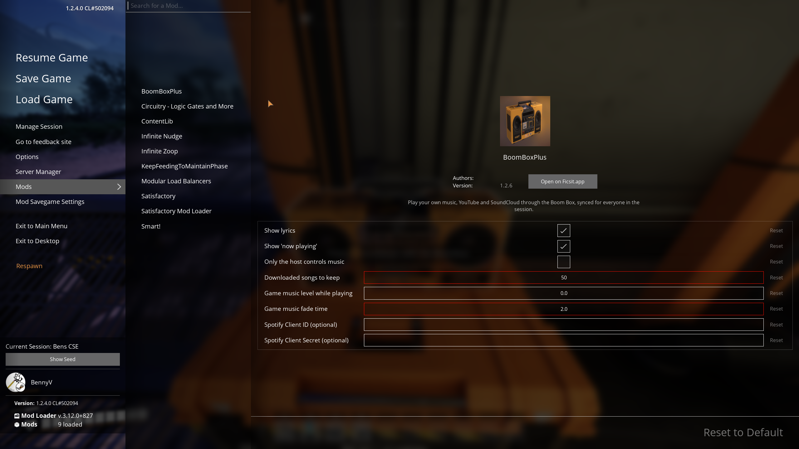

# BoomBoxPlus

A Satisfactory mod that makes the Boom Box play **your** music: songs from your own folder, YouTube, SoundCloud,
whole Spotify playlists and live internet radio. Everyone within earshot hears the same song at the same moment,
with synced lyrics. Inspired by the PEAK mod sPEAKer.

- **Current version:** 1.5.0 ([changelog](Docs/Release/Changelog.md))
- **Needs:** Satisfactory build 513885 or newer (the October 2026 update) and SML 3.12 or newer.
- **Get it:** install **BoomBoxPlus** with Satisfactory Mod Manager. Everyone in a multiplayer session needs it,
  on the same version.

## Features

- **Your own music.** Drop `.mp3`, `.ogg` or `.wav` files into a folder and search them in game.
- **YouTube and SoundCloud.** Type a search and press Enter, or paste a video, track or playlist link.
- **Spotify links.** A song link searches for that song; a playlist or album link matches every song on YouTube,
  and the first ones start playing while the rest are still being found.
- **Internet radio.** Paste a station's stream address (MP3, AAC, OGG, HLS, `.pls`/`.m3u`) or a YouTube live
  stream. The song the station announces becomes the title. The **Radio** tab keeps up to 200 stations to play,
  rename or remove.
- **Import from files** (new in 1.5.0). **Import List** on the Radio tab adds a whole station list at once;
  **Import Playlist** above the queue finds and queues every song in a file. See [Importing lists](#importing-lists).
- **A real queue.** Play Now, Play Next, Add, reorder, remove, clear, shuffle, repeat, and a seek bar.
- **Song history.** The **History** tab lists the last 100 songs each Boom Box played, radio songs included,
  to play again or copy.
- **3D sound.** Music comes from the Boom Box and fades with distance, carried or placed, with an adjustable
  Doppler effect when you drive or fly past.
- **Multiplayer sync.** Same song, same position for everyone, including players who join mid-song. Each Boom
  Box has its own queue, or link several with a 4-digit code to share one.
- **Your own volume per Boom Box**, from 0 to 200%, remembered between sessions.
- **Synced lyrics** at the bottom of the screen, from [LRCLIB](https://lrclib.net) or a `.lrc` file next to your
  song.
- **Looks like Satisfactory**, built from the game's own buttons, fonts and colours. The Boom Box's own screen
  follows along, and the game's soundtrack steps aside while Custom Music plays.

The full player guide (settings, Spotify setup, where files are kept, network and AI disclosures) is the mod
page text in [`Docs/Release/ModPage.md`](Docs/Release/ModPage.md).

## Getting started

1. Pick up or open any Boom Box and press **Custom Music**.
2. Search, then press **Play Now**, **Play Next** or **Add**.
3. For your own files, press **Open Folder** next to Search, put music in it and press **Rescan**. The folder is
   `%LOCALAPPDATA%\FactoryGame\Saved\BoomBoxPlus\Music`.

In multiplayer, a song from your own folder only plays for players who have the same file. YouTube, SoundCloud
and Spotify songs are downloaded by each player automatically.

## Importing lists

Both buttons open the normal Windows **Open** dialog. The game keeps running while it's open; in exclusive
fullscreen the dialog may appear behind the game.

**Stations** (Radio tab → **Import List**). One station per line: a name and its stream address, separated by a
tab, comma, `|` or ` - `. A line with only an address is named after its host. `.pls` and `.m3u` playlists work
too.

```
SUNSHINE LIVE - Drum & Bass	http://stream.sunshine-live.de/dnb/mp3-192
Sunshine:Trance	http://stream.sunshine-live.de/trance/mp3-192
```

Stations are added to the top of your list in file order. Ones you already have are skipped, and an import never
removes saved stations. They aren't test-played on import, so a dead address only shows when you play it.

**Songs** (Queue → **Import Playlist**). One song per line, as "Artist - Title" or a YouTube/SoundCloud link.
Numbering (`1.`, `01 -`), bullets and a trailing length (`3:45`) are fine. `.m3u` playlists and CSV exports with
title and artist columns also work, such as a Spotify playlist exported with
[Exportify](https://github.com/watsonbox/exportify).

```
1. Daft Punk - One More Time  5:20
2. Kavinsky - Nightcall
https://www.youtube.com/watch?v=VIDEO_ID
```

Each song is found on YouTube and queued in file order, up to 1000 songs. The first ones start playing while the
rest are still being looked up, and the import carries on if you close the window.

## Screenshots

The Custom Music page: now playing with its source, Copy Link, the current lyric, the seek bar and the queue.



Search results from YouTube and SoundCloud, each with Play Now, Play Next and Add.



The now-playing notification for a radio station: the song it announces, the artist and the station.



A Spotify playlist being matched on YouTube; **Add all** queues the songs as they're found.





The current lyric line while a Boom Box plays nearby, placed or carried.





The Boom Box's own screen following Custom Music, and the Custom Music tape in the tape list.





The settings in **Mods → BoomBoxPlus**.



## For developers

- Developer documentation is in [`Docs/`](Docs/Architecture.md), starting with
  [`Architecture.md`](Docs/Architecture.md). [`UI.md`](Docs/UI.md) covers the Custom Music page, including the
  tabs and list import; [`NetSources.md`](Docs/NetSources.md) covers YouTube, SoundCloud, Spotify and downloads;
  [`Multiplayer.md`](Docs/Multiplayer.md) covers sync.
- Release texts: [`Docs/Release/`](Docs/Release/) (changelog, mod page, Discord announcement).

### Building

1. Run `Tools/FetchTools.ps1` to download the pinned yt-dlp and FFmpeg into `Resources/Tools/` (not committed).
   The ADA easter-egg voice lines (`Resources/Audio/ADA/`) aren't committed either, so a build from this
   repository has no easter eggs; see [`Docs/EasterEggs.md`](Docs/EasterEggs.md).
2. Build and package with Alpakit, or the `PackagePlugin` UAT command, against the SML starter project for game
   build 513885 (Wwise 2025.1). Then run `Tools/TrimServerPackages.py` to drop the media tools from the server
   packages, which never use them. See [`Docs/Packaging.md`](Docs/Packaging.md).

## Credits

- Demo track: "Monkeys Spinning Monkeys" Kevin MacLeod (incompetech.com). Licensed under Creative Commons:
  By Attribution 4.0 License — http://creativecommons.org/licenses/by/4.0/
- [yt-dlp](https://github.com/yt-dlp/yt-dlp) (Unlicense) and [FFmpeg](https://ffmpeg.org) 8.1.3 (LGPL v3,
  BtbN shared build), bundled.
- Audio decoders: [dr_mp3 and dr_wav](https://github.com/mackron/dr_libs) (public domain / MIT-0),
  [stb_vorbis](https://github.com/nothings/stb) (public domain).
- Synced lyrics: [LRCLIB](https://lrclib.net).
